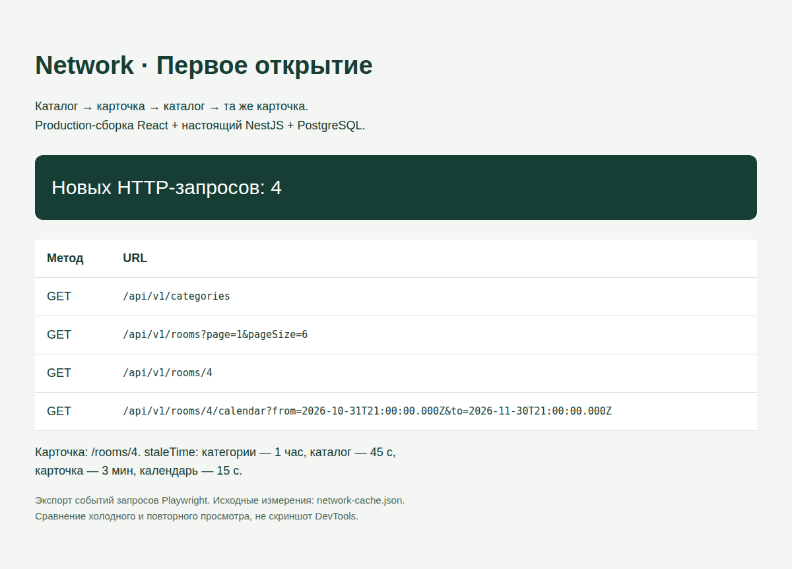
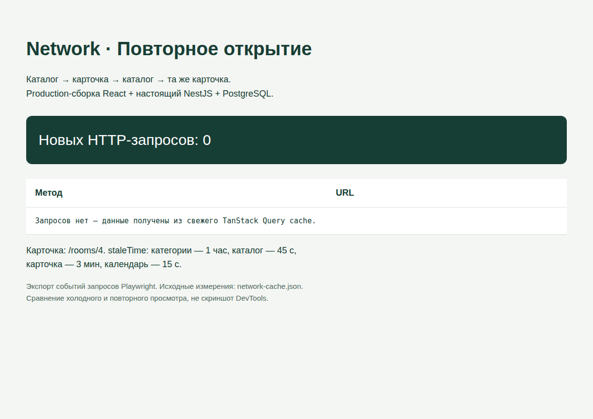

# Отчёт по оптимизации и кэшированию приложения Arendo

Команда №5 «ЧЕКЛИ». Тема: аренда помещения на определённый период. Аналитик: Коржнев М.Д.

## 1. Цель и объект

Цель — уменьшить нагрузку на сервер и базу данных и сократить время ответа. Объект — веб-приложение Arendo: клиент на React, сервер на NestJS, база данных PostgreSQL.

Отчёт опирается на измерения разработчиков серверной и клиентской части и на проверки тестировщика. Замеры SQL и передачи данных сделаны на этапе оптимизации, до добавления отзывов, штрафов, чёрного списка и управления помещениями в интерфейсе.

## 2. Анализ производительности

### 2.1. Методика

* База: PostgreSQL 15.20 в Docker, 12 004 помещения, 120 006 аренд, 24 005 фото, 8 574 отзыва, обновлённая статистика (`ANALYZE`).
* SQL: 3 прогона для прогрева и 20 измерений `EXPLAIN (ANALYZE, BUFFERS, TIMING OFF)` на каждый запрос.
* HTTP: 5 прогревочных и 30 измеряемых запросов на сценарий, одно соединение keep-alive, `Accept-Encoding: gzip`.
* Медленные запросы: в PostgreSQL включён журнал `log_min_duration_statement = 10 мс`.
* Корректность: результаты до и после сравнивались по SHA-256 и совпали.

### 2.2. Найденные узкие места

| Узкое место | Причина |
|---|---|
| Первая страница каталога по цене | рейтинг считался для всех 12 004 помещений до выбора страницы |
| Каталог с фильтрами и по рейтингу | агрегация отзывов и проверка свободного периода по большому набору строк |
| Объём ответов каталога | 100 помещений занимали около 44 КБ несжатого JSON |
| Повторные запросы клиента | одни и те же категории и карточки запрашивались заново |

Календарь одного помещения узким местом не был: запрос выполнялся за 0,045 мс по GiST-индексам.

## 3. Оптимизация запросов к базе данных

### 3.1. Что изменено

* Для сортировки по цене и новизне фото и рейтинг загружаются после выбора страницы, только для её 20 помещений.
* Для сортировки по рейтингу отзывы агрегируются по идентификатору помещения до пагинации.
* Выборка ограничена: перечислены только нужные поля, страница по умолчанию 20 записей, максимум 100.
* Проверка свободного периода использует функцию `fn_room_is_free` и индексы категории и цены.

### 3.2. Индексы

| Индекс | Назначение |
|---|---|
| `rooms_price_idx` (только активные помещения) | сортировка и фильтр по цене |
| `rooms_category_idx` (только активные) | фильтр по категории |
| `bookings_no_overlap`, `room_blocks_no_overlap` (GiST) | календарь и запрет пересечений |
| `bookings_tenant_idx` | список аренд пользователя |
| `reviews_room_idx` | отзывы и рейтинг помещения |

Аудит на работающей базе: повторяющихся индексов нет, все обычные индексы использовались; без обращений остались только первичные ключи и ограничения уникальности.

### 3.3. Результаты, миллисекунды

| Сценарий | Медиана до | Медиана после | P95 до | P95 после |
|---|---|---|---|---|
| Каталог по цене, первая страница | 17,774 | 0,885 | 18,953 | 1,109 |
| Каталог с фильтрами и свободным периодом | 18,413 | 11,193 | 28,612 | 12,306 |
| Каталог по рейтингу | 17,129 | 12,155 | 18,761 | 14,843 |
| Календарь на месяц | 0,045 | 0,046 | 0,054 | 0,065 |

Каталог по цене ускорился примерно в 20 раз, с фильтрами и по рейтингу — на 39 % и 29 % по медиане. Календарь не изменился: его оптимизировать не требовалось.

## 4. Кэширование на сервере

Используется `@nestjs/cache-manager` с хранилищем в памяти процесса (до 2000 записей). Ключ строится из группы, её версии и SHA-256 параметров запроса.

| Данные | Срок жизни | Когда сбрасывается |
|---|---|---|
| Категории | 1 час | создание, изменение, удаление категории или её иконки |
| Каталог | 45 с | изменение помещения, фото, отзыва |
| Каталог с периодом (доступность) | 45 с | аренда, отмена, закрытие периода |
| Карточка помещения | 3 минуты | изменение помещения, фото, отзыва |
| Календарь | 15 с | аренда, отмена, приёмка, закрытие периода, активация по времени |

Обновление устроено через версии: при изменении данных номер версии группы увеличивается, и старые ключи перестают читаться. Запрос, начатый до изменения, может заполнить только старую версию, поэтому устаревший ответ не попадёт в новую.

Личные данные (аренды, профиль, штрафы, чёрный список) не кэшируются и отдаются с `Cache-Control: no-store`.

Работа кэша видна в журнале сервера по строкам `HIT` и `MISS`:

```
[PublicCache] MISS categories
[PublicCache] HIT categories
[PublicCache] MISS catalog
[PublicCache] HIT catalog
```

## 5. Оптимизация передачи данных

* Ответы JSON от 512 байт сжимаются gzip (уровень 4).
* Публичные ответы получают `ETag` и `Cache-Control: public, no-cache`: клиент перепроверяет данные и при совпадении получает `304` без тела.
* Каталог разбит на страницы.

| Сценарий | Тело до, байт | Тело после, байт | Медиана до, мс | Медиана после, мс |
|---|---|---|---|---|
| Каталог, 20 помещений | 8 828 | 982 | 0,882 | 1,247 |
| Каталог, 100 помещений | 43 993 | 3 669 | 1,839 | 2,164 |
| Категории | 675 | 351 | 0,561 | 0,688 |
| Карточка помещения | 464 | 464 | 0,633 | 0,655 |
| Условный запрос с совпавшим ETag | 0 | 0 | 1,517 | 1,735 |

Объём тела сократился до 92 %. Время ответа по локальной сети немного выросло из-за сжатия; выигрыш проявляется на медленном канале, где важен объём. Это измерение сделано локально, на реальном канале оно не проверялось.

## 6. Кэширование и оптимизация на клиенте

TanStack Query хранит ответы и не повторяет запрос, пока данные свежие.

| Данные | staleTime |
|---|---|
| Категории | 1 час |
| Каталог с фильтрами и страницей | 45 с |
| Карточка помещения, отзывы | 3 минуты |
| Календарь, список аренд | 15 с |

* Поиск ждёт 350 мс после ввода, устаревший запрос отменяется через `AbortSignal`.
* Карточка загружается заранее при наведении на неё.
* После аренды, отмены и приёмки сбрасываются только связанные запросы.

Результат проверки с настоящим сервером: первое открытие каталога и карточки — 4 запроса, повторное — 0; быстрый набор в поиске — 1 запрос.





## 7. Статические файлы и CDN

* Демонстрационные фото в формате WebP (50–240 КБ) с кэшем на 30 дней, на карточках ленивая загрузка `loading="lazy"`.
* Имена файлов сборки содержат хэш; Nginx отдаёт их с `Cache-Control: public, max-age=31536000, immutable`, а HTML — с `no-cache`.
* CDN описан (Cloudflare: кэшировать только `/assets/`, для API и HTML кэш отключить), но не подключён: нет домена и реального сервера.

## 8. Мониторинг и инструменты

* `EXPLAIN (ANALYZE, BUFFERS)` и журнал медленных запросов PostgreSQL;
* скрипты замеров `backend/benchmarks` (SQL и HTTP);
* журнал попаданий в кэш на сервере;
* перехват сетевых запросов браузера тестами Playwright;
* проверка состояния `GET /api/v1/health` и healthcheck контейнеров.

Нагрузочная проверка на стенде Docker Compose (4 помещения): 1000 запросов каталога при 100 параллельных — 0 ошибок, 677 запросов в секунду, p50 136 мс, p95 192 мс. 100 одновременных попыток забронировать одно время — проходит ровно одна.

## 9. Доступность и надёжность

* Кэш только ускоряет чтение: при его потере данные читаются из базы.
* Пересечение аренд запрещает сама база данных, поэтому устаревший календарь не приводит к двойной брони.
* Контейнеры перезапускаются автоматически; сервер стартует после готовности базы.
* Резервная копия базы делается раз в сутки и хранится 14 дней; восстановление проверено.

## 10. Нерешённые вопросы

* Кэш живёт в памяти одного процесса. Для нескольких экземпляров сервера нужен общий кэш, например Redis.
* Изменения, внесённые в базу напрямую, кэш не сбрасывают: они видны после истечения срока жизни.
* Замеры на большом объёме не повторялись после добавления новых функций.
* Нагрузка 500 одновременных пользователей и доступность 99 % за месяц не проверялись.
* CDN, HTTPS и реальный сервер не настроены.
* Каталог использует постраничную выборку `LIMIT/OFFSET`; на дальних страницах большой базы выгоднее выборка по ключу.

## 11. Выводы

Основное узкое место — расчёт рейтинга для всех помещений перед выбором страницы — устранено. Повторные просмотры не создают запросов, объём ответов каталога сокращён более чем в восемь раз, а актуальность календаря сохранена за счёт сброса кэша при изменениях.
