# Руководство пользователя веб-приложения Arendo

Команда №5 «ЧЕКЛИ». Аналитик: Коржнев М.Д.

## 1. О приложении

Arendo — сервис аренды помещений по часам и суткам: конференц-залы, коворкинги, фотостудии, склады.

| Роль | Что может |
|---|---|
| Гость | смотреть каталог, карточки, календарь и отзывы |
| Арендатор | бронировать, отменять ожидающие аренды, оставлять отзывы, видеть свои штрафы |
| Владелец | размещать и вести помещения, принимать их после аренды, оценивать арендаторов |
| Администратор | управлять доступом пользователей, категориями, штрафами и чёрным списком |

Приложение работает в современном браузере на компьютере и телефоне. Кнопка с луной или солнцем в верхней панели переключает светлую и тёмную темы.

## 2. Регистрация и вход

1. Нажмите «Регистрация».
2. Выберите, что хотите делать: «Арендовать» или «Сдавать».
3. Введите имя и фамилию, email, пароль не короче 8 символов; телефон указывать необязательно, его можно записать как 79991234567, +79991234567 или +7 (999) 123-45-67.
4. Нажмите «Зарегистрироваться».

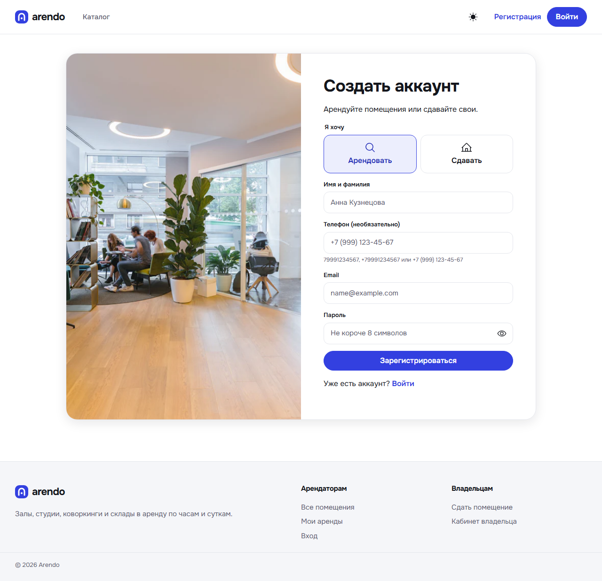

Для входа нажмите «Войти», введите email и пароль. После нескольких неудачных попыток подряд вход ненадолго блокируется — подождите минуту. Чтобы выйти, нажмите значок выхода рядом со своим именем.

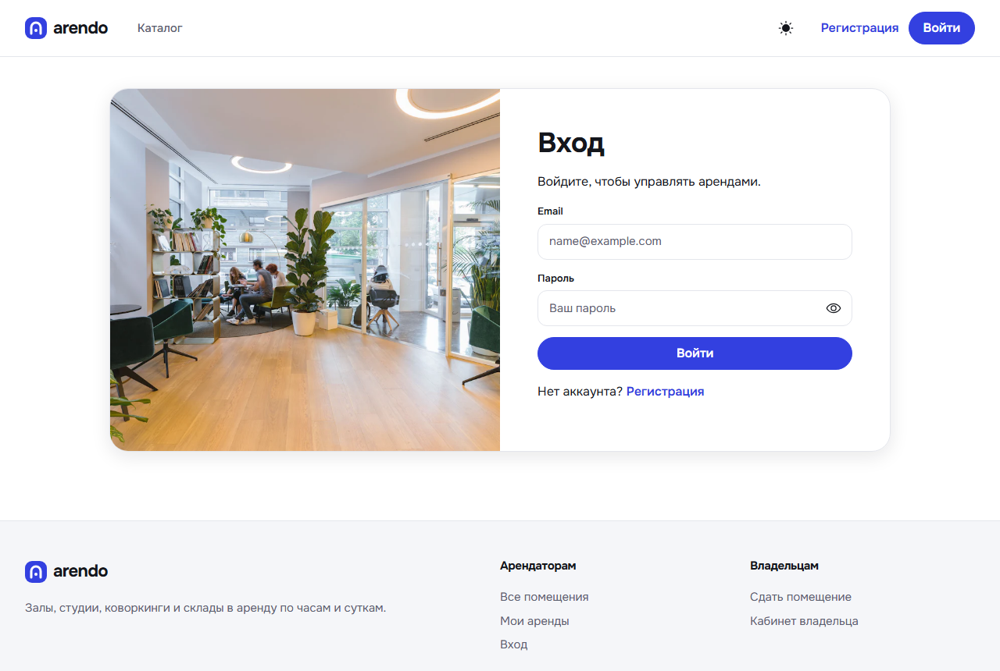

## 3. Поиск помещения

В каталоге можно:

* искать по названию или адресу;
* выбрать, когда помещение должно быть свободно, и число гостей, затем нажать «Найти»;
* выбрать категорию в строке под поиском;
* задать цену от и до и порядок сортировки;
* листать страницы кнопками «Назад» и «Далее».

Метка «Новое» на фото означает, что у помещения ещё нет оценок. Если фотографий нет, на их месте пустая рамка «Нет фото».

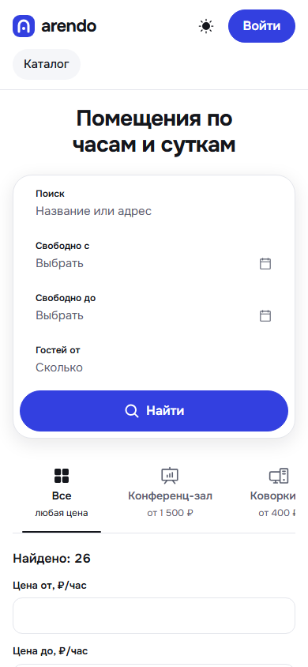

## 4. Карточка помещения

В карточке показаны площадь, вместимость, цены, описание, фото, календарь занятости и отзывы.

Фото листаются стрелками на снимке, миниатюрами под ним или жестом на телефоне. Нажмите на фото, чтобы открыть его во весь экран; листать можно и там, закрыть — крестиком или клавишей Esc.

Календарь: выберите день — ниже появятся часы этого дня. Цвет показывает состояние: свободно, выбрано, ожидает, занято, закрыто владельцем, прошло. Точка под днём означает, что в этот день есть занятые часы.

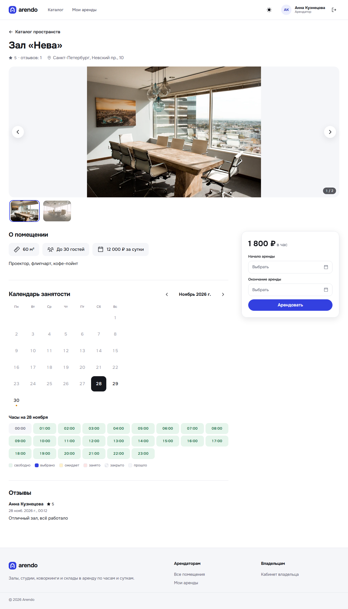

## 5. Руководство арендатора

### 5.1. Как арендовать

1. Откройте карточку помещения.
2. Выберите начало и окончание аренды в полях справа или часы в календаре.
3. Нажмите «Арендовать». Появится сообщение, что аренда создана.

Правила: начало — в будущем, длительность — не более 30 суток, время не должно пересекаться с другими арендами и закрытыми периодами. Стоимость рассчитывается по почасовой или суточной цене.

### 5.2. Мои аренды

Раздел «Мои аренды» показывает все аренды с фильтром по статусу.

| Статус | Значение |
|---|---|
| Ожидает | аренда оформлена, время ещё не наступило |
| Активно | идёт сейчас; переключается автоматически |
| Завершено | владелец принял помещение; отменить уже нельзя |
| Отменено | аренда отменена |

* Отменить можно только ожидающую аренду: «Отменить аренду», затем подтвердить.
* «История статусов» показывает, когда статус менялся.
* После завершения доступна кнопка «Оставить отзыв»: поставьте от 1 до 5 звёзд и напишите комментарий. Отзыв оставляется один раз.

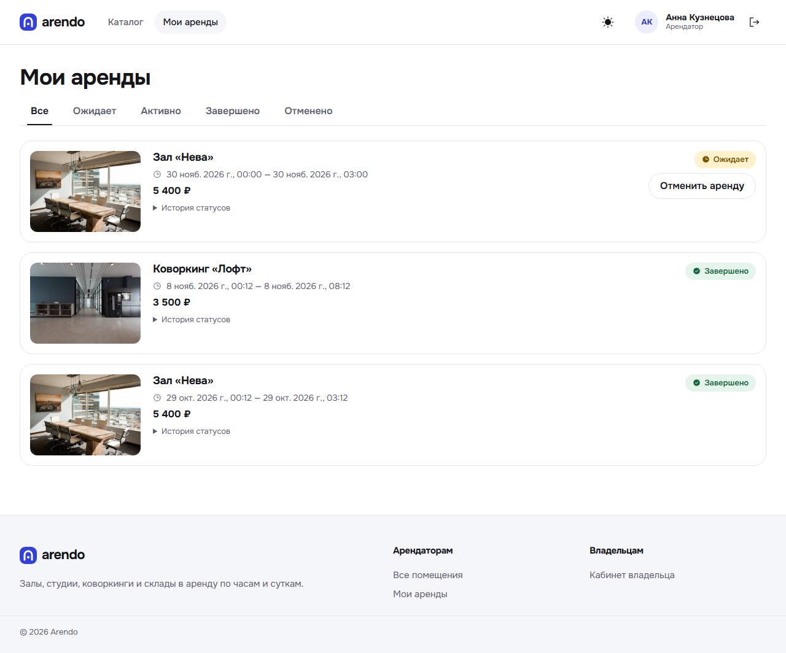

### 5.3. Штрафы и ограничения

Если помещение возвращено позже окончания аренды более чем на 15 минут, начисляется штраф: 1,5 почасовой ставки за каждый начатый час просрочки. После второй просрочки выносится предупреждение, после третьей аренда блокируется. Штрафы видны под списком аренд.

## 6. Руководство владельца

### 6.1. Мои помещения

Раздел «Мои помещения» — список ваших помещений.

1. Раскройте «Добавить помещение».
2. Заполните название, адрес, категорию, площадь, вместимость, цену за час; цена за сутки и описание необязательны.
3. При желании выберите фото: JPEG, PNG или WebP до 5 МБ, не больше 10; первое станет главным.
4. Нажмите «Добавить».

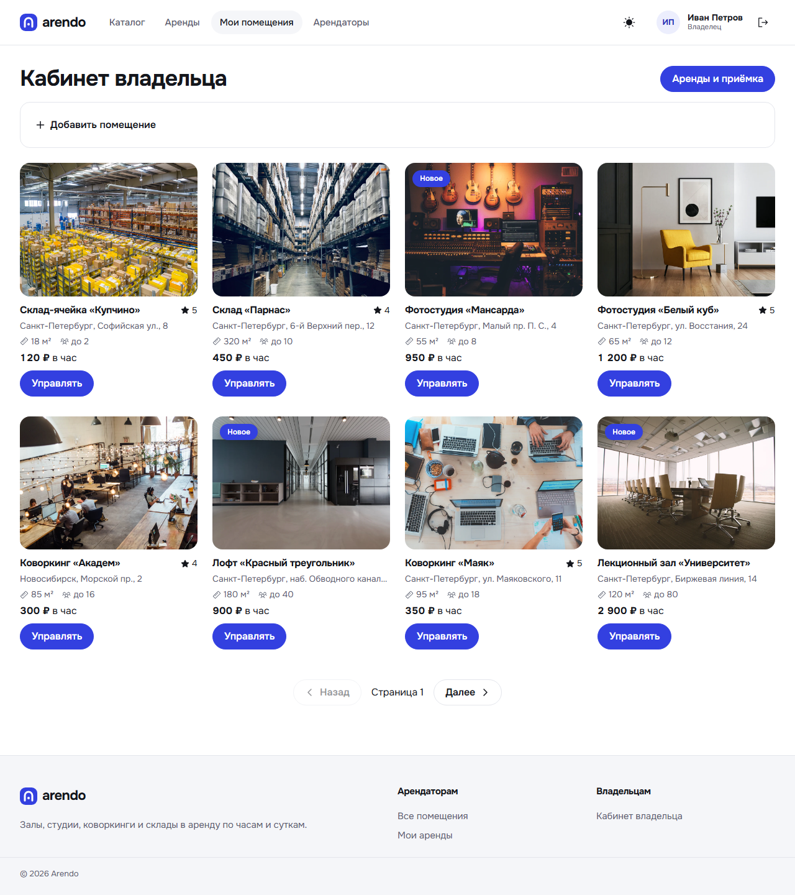

### 6.2. Управление помещением

Кнопка «Управлять» открывает настройки:

* «Описание и цены» — измените поля и нажмите «Сохранить»;
* «Фото» — «Добавить фото»: JPEG, PNG или WebP до 5 МБ, не больше 10; лишнее фото можно удалить;
* «Закрытые периоды» — укажите начало, конец и причину, нажмите «Закрыть период», если помещение временно не сдаётся;
* «Снять с публикации» — помещение исчезнет из каталога, история сохранится. Нельзя, пока есть ожидающие или активные аренды.

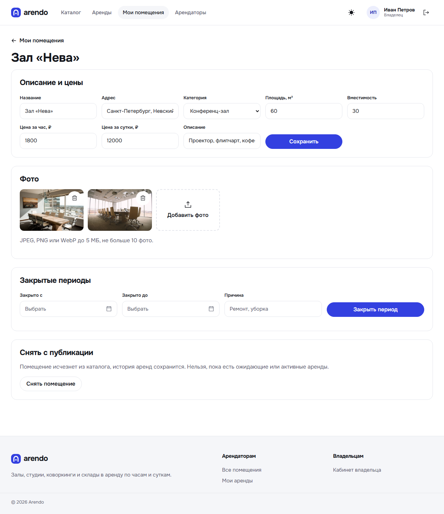

### 6.3. Аренды и приёмка

Раздел «Аренды» (или кнопка «Аренды и приёмка») показывает аренды ваших помещений.

* Когда арендатор освободил помещение, нажмите «Принять помещение» и подтвердите. Если срок прошёл, штраф начислится автоматически.
* Активную аренду своего помещения можно отменить.
* После завершения доступна кнопка «Оценить арендатора».

### 6.4. Арендаторы, штрафы и чёрный список

В разделе «Арендаторы» — все, кто арендовал ваши помещения: рейтинг, число аренд, просрочки и долг. Ниже — чёрный список и штрафы. Штраф можно отметить кнопкой «Оплачен» или «Списать».

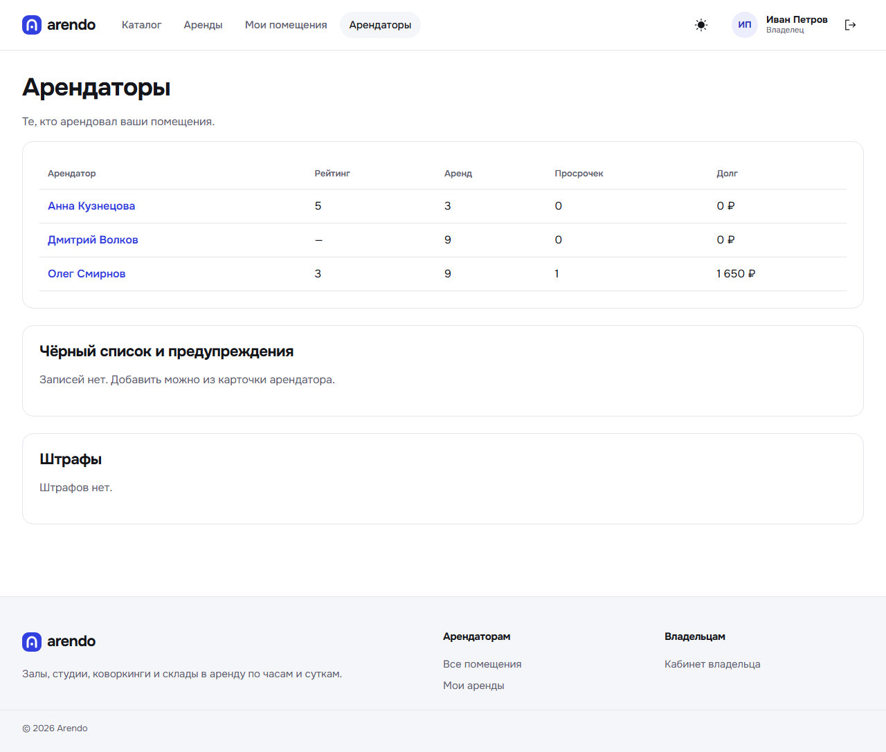

Нажмите на имя, чтобы открыть карточку арендатора: контакты, статистика, история аренд и штрафы. В блоке «Чёрный список» выберите «Предупреждение» или «Запретить аренду», укажите причину и нажмите «Добавить». Запрет действует только на ваши помещения. Снять его можно кнопкой «Снять» в разделе «Арендаторы».

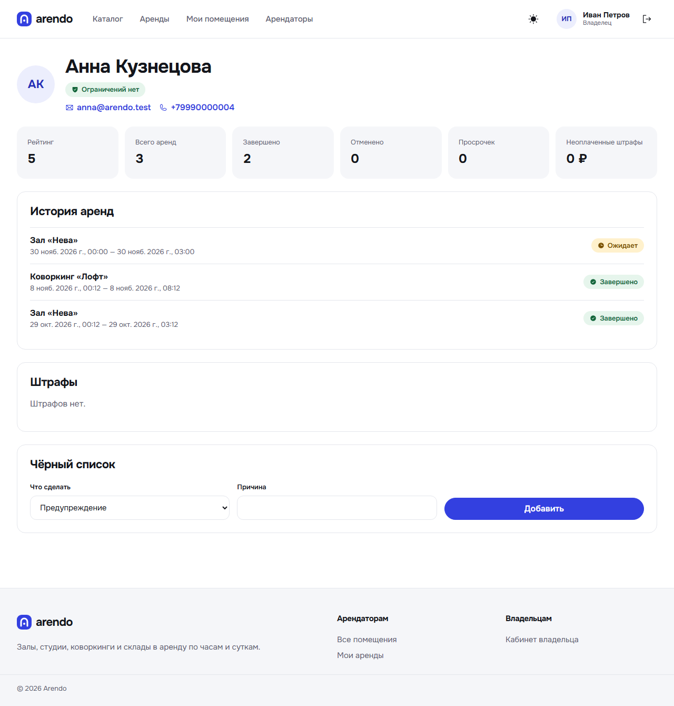

## 7. Руководство администратора

Раздел «Администрирование»:

* «Пользователи» — кнопки «Заблокировать» и «Разблокировать». Заблокированный пользователь сразу выходит из системы. Разблокировка снимает и общий запрет аренды. Себя заблокировать нельзя.
* «Категории помещений» — добавить категорию, изменить цену «от», удалить пустую категорию.

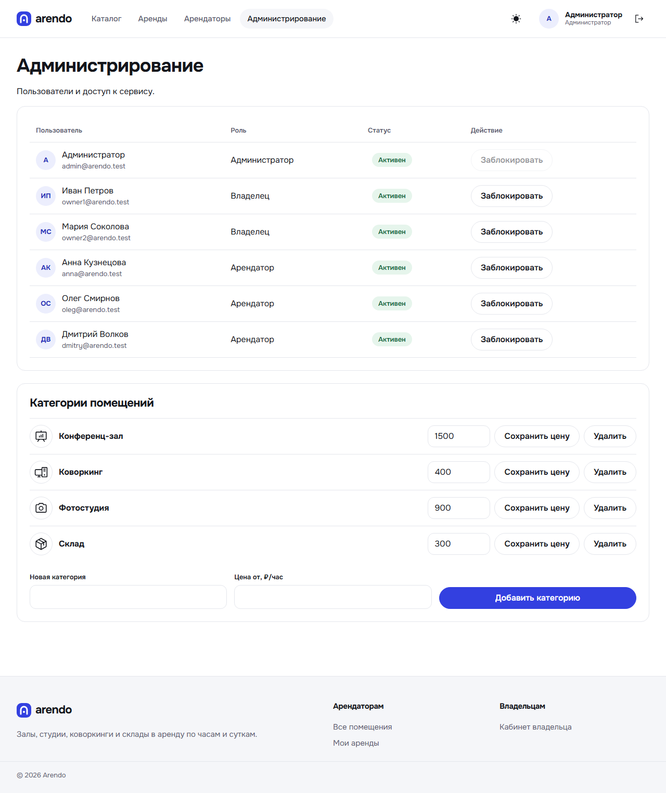

Чтобы изменить иконку категории, нажмите на неё, выберите значок из набора или загрузите свой файл (PNG, JPEG или WebP до 512 КБ), затем «Сохранить».

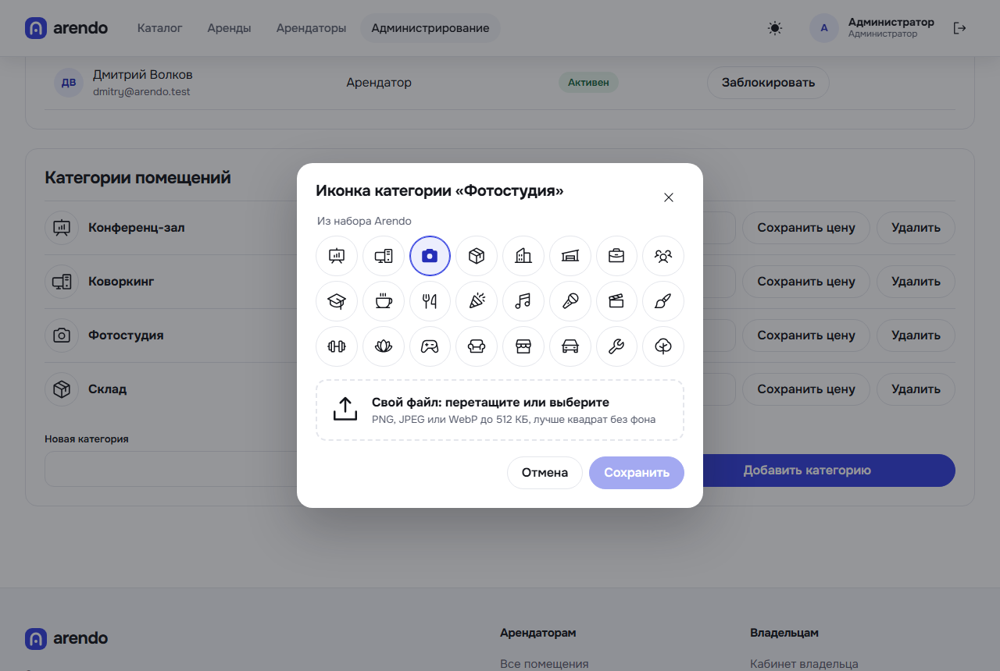

В разделе «Арендаторы» администратор видит всех арендаторов и может накладывать ограничения на весь сервис.

## 8. Возможные сообщения и что делать

| Сообщение или ситуация | Что делать |
|---|---|
| Неверный email или пароль | проверьте адрес и раскладку; пароль можно посмотреть значком глаза |
| Слишком много попыток | подождите минуту |
| Время занято или конфликт данных | выберите другое время по календарю |
| Сессия истекла | войдите снова |
| Нет доступа | раздел не предназначен для вашей роли |
| Нет связи с сервером | проверьте подключение и нажмите «Повторить» |

Восстановление забытого пароля и онлайн-оплата в приложении не предусмотрены.
