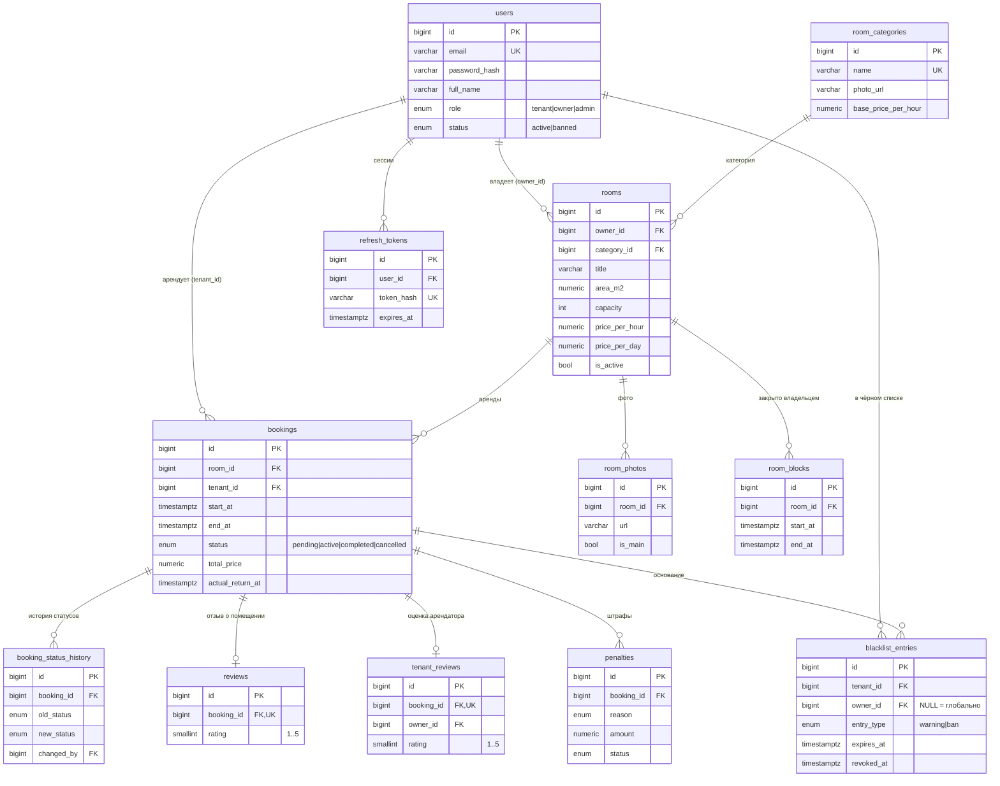
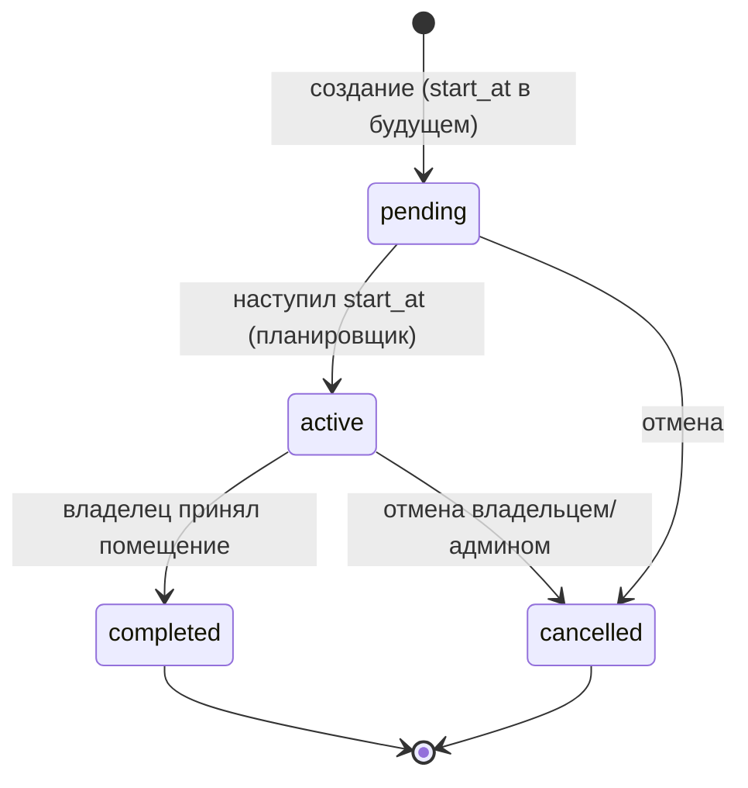

# База данных Arendo

СУБД: **PostgreSQL 15+** (стенд — PostgreSQL 16). Расширенные тестовые данные: [`05_demo_data.sql`](../../db/05_demo_data.sql). Скрипты: [`db/01_schema.sql`](../../db/01_schema.sql) → [`02_logic.sql`](../../db/02_logic.sql) → [`03_seed.sql`](../../db/03_seed.sql); примеры запросов — [`04_queries.sql`](../../db/04_queries.sql); автотесты — [`db/tests`](../../db/tests).

## 1. ER-диаграмма

## 2. Таблицы

| Таблица | Назначение |
|---|---|
| `users` | Пользователи всех ролей (арендатор, владелец, администратор), статус `active/banned` |
| `refresh_tokens` | Хэши refresh-токенов (можно отозвать сессию) |
| `room_categories` | Категории помещений: название, фото, ориентировочная цена за час |
| `rooms` | Помещения: владелец, категория, площадь, вместимость, цены за час/сутки |
| `room_photos` | Фото помещения, одно главное |
| `room_blocks` | Периоды, закрытые владельцем (ремонт) — «занято» в календаре |
| `bookings` | **Аренды** на период `[start_at, end_at)` со статусом и ценой |
| `booking_status_history` | Журнал смены статусов (кто и когда) |
| `reviews` | Отзыв арендатора о помещении (1 на аренду) |
| `tenant_reviews` | Оценка арендатора владельцем → общий рейтинг клиента |
| `penalties` | Штрафы (просрочка возврата, ущерб) |
| `blacklist_entries` | Предупреждения и баны (глобальные от админа или в списке владельца) |

## 3. Статусы аренды (привязка ко времени)

* `pending → active` возможен только если `start_at <= now()` (триггер `trg_bookings_status_guard`).
* Из `completed` и `cancelled` выхода нет — попытка вызывает ошибку «Нельзя изменить статус завершённой аренды».
* У закрытых аренд нельзя менять даты, помещение, арендатора и цену (`trg_bookings_freeze_closed`).
* «Просрочено» — вычисляемый признак: `status = 'active' AND now() > end_at`.

## 4. Бизнес-правила, реализованные в БД

| Правило | Механизм |
|---|---|
| Нельзя двойное бронирование | `EXCLUDE USING gist (room_id WITH =, tstzrange(start_at,end_at) WITH &&) WHERE status IN ('pending','active')` — работает даже при гонке запросов |
| Нельзя арендовать в закрытый владельцем период и нельзя закрыть поверх аренды | триггеры `trg_bookings_before_insert`, `trg_room_blocks_check` |
| Нельзя арендовать в прошлом, своё помещение, владельцу/админу | `trg_bookings_before_insert` |
| Бан/чёрный список блокирует аренду | `fn_is_blacklisted` |
| Цена считается автоматически (почасовая, дневная — если выгоднее) | `fn_calc_price` |
| Просрочка возврата > 15 мин → штраф 1,5 × ставка за каждый начатый час; 2-я просрочка → предупреждение; 3-я → автобан | `fn_complete_booking` |
| Отзыв — только по завершённой аренде, один на аренду, автор = арендатор этой аренды | `trg_reviews_check` + составной внешний ключ |
| Рейтинг клиента = среднее оценок владельцев, плюс число просрочек и неоплаченные штрафы | представление `v_tenant_stats` |

## 5. Нормализация

* **1НФ** — все поля атомарны (телефон, адрес — одно значение; фото вынесены в `room_photos`).
* **2НФ/3НФ** — у всех таблиц суррогатный первичный ключ, неключевые атрибуты зависят только от него: данные категории хранятся в `room_categories`, а не копируются в `rooms`; имя владельца берётся из `users`.
* **Осознанная денормализация:** `reviews.room_id/tenant_id` дублируют данные аренды, чтобы быстро выбирать отзывы по помещению. Согласованность гарантируется составным внешним ключом `(booking_id, room_id, tenant_id) → bookings(id, room_id, tenant_id)`. `bookings.total_price` фиксируется на момент аренды (цена помещения потом может измениться).

## 6. Индексы и оптимизация

| Индекс | Зачем |
|---|---|
| `bookings_no_overlap` и `bookings_room_period_idx` (GiST по `room_id` + диапазон) | проверка пересечений и календарь занятости |
| `bookings_tenant_idx (tenant_id, start_at DESC)` | «мои аренды» |
| `bookings_status_start_idx` (частичный, только `pending/active`) | планировщик статусов |
| `users_email_uq (lower(email))` | вход по email без учёта регистра |
| `rooms_category_idx`, `rooms_price_idx` (частичные, `WHERE is_active`) | фильтры каталога |
| `room_photos_one_main_uq` (частичный уникальный) | не более одного главного фото |
| `blacklist_tenant_idx` (частичный, `revoked_at IS NULL`) | быстрая проверка бана |

Анализ — `EXPLAIN (ANALYZE)`; автотест подтверждает использование индекса на 3000+ строк.

Планы и результаты замеров на 12 004 помещениях и 120 006 арендах доступны в [отчёте по производительности каталога и календаря](../reports/Backend_Performance.md).

## 7. Целостность и безопасность

* Внешние ключи везде; `ON DELETE CASCADE` только для зависимых данных (фото, токены, история), финансовые и исторические записи физически не удаляются — помещения деактивируются (`is_active`).
* `CHECK`-ограничения: цены > 0, рейтинг 1..5, `end_at > start_at`, длительность ≤ 30 дней, формат email/телефона, согласованность `status = cancelled ⇔ cancelled_at IS NOT NULL`.
* Пароли — только хэш (bcrypt); refresh-токены — хэш.
* Приложение подключается отдельной ролью с минимальными правами (без `DROP/ALTER`), запросы параметризованные (защита от SQL-инъекций).
* Резервное копирование: ежедневный `pg_dump`, копии хранятся 14 дней.
